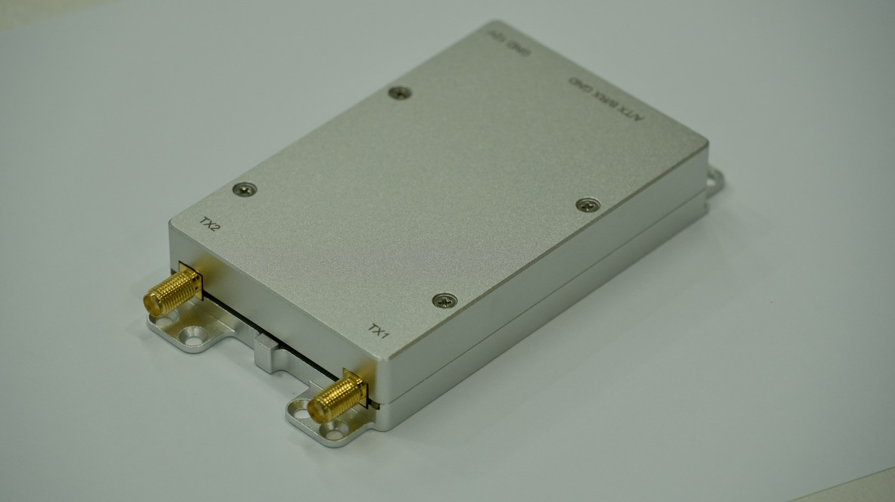
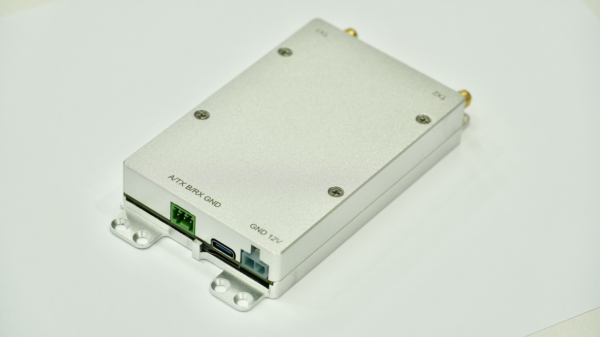

# 信源上位机

**面向 400M 瞬时带宽信号源设备的桌面控制软件**

连接兼容设备后，可在电脑上查看运行状态、调整信号参数，并进行扫频测试。

[国内下载 · Gitee](https://gitee.com/JetKeey/yaics-pubilc/releases) · [国外下载 · GitHub](https://github.com/zhang12c/YaicsPubilc/releases)

## 设备一览

| 射频接口侧 | 控制与供电接口侧 |
|:---:|:---:|
|  |  |

## 可以用它做什么

| 功能 | 用途 |
| --- | --- |
| 连接与查看 | 通过串口连接兼容设备，查看模块、频率、波形和信号开关状态。 |
| 信号参数设置 | 调整起止频率、衰减值（ATT）、波形和信号开关，并查看保存进度。 |
| 开窗配置 | 设备协议支持时，查询和设置开窗频段。 |
| 扫频测试 | 配置扫频范围、步进和间隔，查看目标频率、设备回报及测试进度。 |
| 通信与更新 | 按需查看串口通信信息；联网时检查下一版本并提供下载入口。 |

## 三步开始使用

1. 根据操作系统和处理器，从上方发行版页面下载对应 ZIP，解压后运行程序。提供 Windows、macOS、Linux 的 x64 和 ARM64 包。
2. 按设备说明完成连接，在软件顶部选择串口和波特率，点击“打开”。
3. 在“运行信息”中查看设备状态；调整参数后点击“保存”。需要时进入“扫频测试”或“通讯信息”页面。

> 本软件需要配套的兼容信号源设备。开窗、扫频等功能的可用情况取决于设备协议和配置。

## 近期更新

2026 年 10 月 24 日至 11 月 24 日：

- 增加多语言界面切换，支持中文、英语、日语、韩语、西班牙语、法语、德语、葡萄牙语（巴西）、俄语和阿拉伯语。
- 优化不同版本设备的信号类型协议兼容、波形名称显示与界面页签。
- 完善扫频测试的参数校验、波形回读确认，以及断连和超时提示。
- 增加操作进度提示、当前软件版本显示和新版本下载提醒。
- 修复空引用及串口通信相关问题。

## 下载

- [Gitee 发行版（国内）](https://gitee.com/JetKeey/yaics-pubilc/releases)
- [GitHub Releases（国外）](https://github.com/zhang12c/YaicsPubilc/releases)
